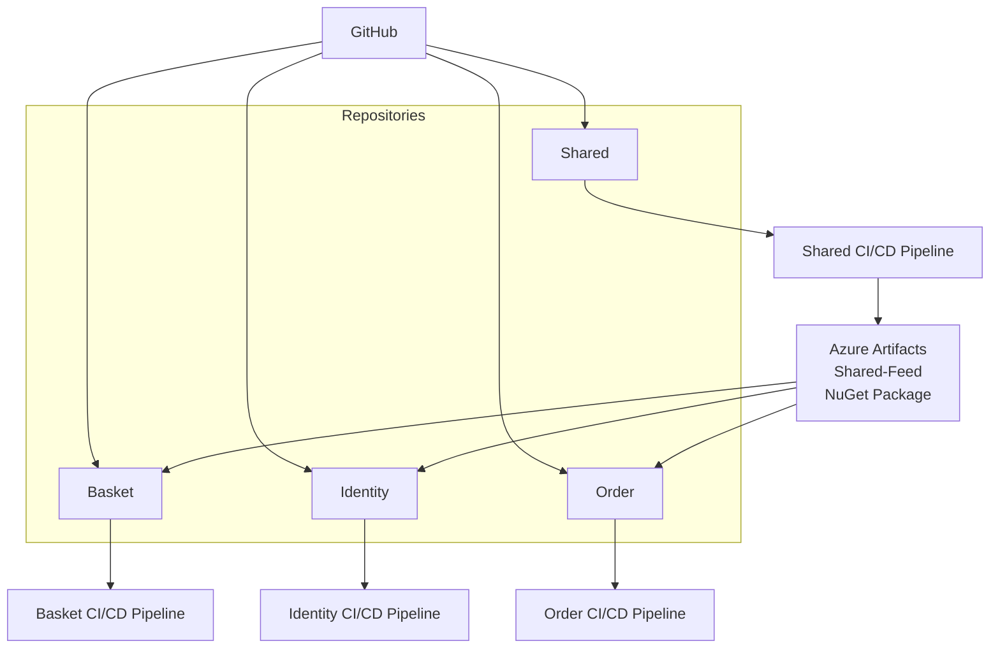

# 👋 Hi, I'm Sima Pirani

### Project Delivery & PMO Specialist | Business Analysis | Azure DevOps

I am a delivery-focused professional with experience in software project delivery, business analysis, process improvement, and DevOps practices.

I focus on bridging business requirements and technical implementation, improving project workflows, and delivering maintainable software solutions.

I am particularly interested in:
- Business Analysis and Requirements Management
- Project Delivery and PMO Practices
- Azure DevOps and CI/CD Automation
- Software Architecture and .NET Development
- Process Improvement and ISO/IMS Compliance

---

## 🛠️ Technologies & Tools

| Category | Technologies |
|---|---|
| Programming | C#, .NET 10 |
| Backend Development | ASP.NET Core Web API |
| Package Management | NuGet |
| DevOps & CI/CD | Azure DevOps Classic Pipelines |
| Source Control | Git, GitHub |
| Development Tools | Visual Studio |

---

## 🚀 Featured Project

### MultiRepo-Architecture

A practical .NET project demonstrating a Multi-Repository architecture with independent applications, reusable components, NuGet package distribution, and CI/CD automation using Azure DevOps.

**Key Features:**
- Four independent Git repositories.
- Shared .NET Class Library.
- NuGet package publishing through Azure DevOps Artifacts.
- Independent application development.
- Automated CI/CD pipelines.
- Centralized reusable components.

**Project Repository:**

[MultiRepo-Architecture](https://github.com/simapirani-git/MultiRepo-Architecture)

---

## 🏗️ Project Architecture

The project follows a Multi-Repository approach rather than a Monolithic Repository structure.



**Architecture Overview:**

- **Shared:** A reusable .NET Class Library published as a NuGet package.
- **Basket:** An independent ASP.NET Core Web API consuming Shared.
- **Identity:** An independent ASP.NET Core Web API consuming Shared.
- **Order:** An independent ASP.NET Core Web API consuming Shared.
- **Azure Artifacts:** Hosts and distributes the Shared NuGet package.
- **Azure DevOps:** Manages independent Classic CI/CD pipelines.

---

## 📦 My Repositories

| Repository | Description |
|---|---|
| [Shared](https://github.com/simapirani-git/Shared) | Reusable .NET Class Library |
| [Basket](https://github.com/simapirani-git/Basket) | Basket Web API |
| [Identity](https://github.com/simapirani-git/Identity) | Identity Web API |
| [Order](https://github.com/simapirani-git/Order) | Order Web API |

---

## 🎯 Project Objectives

- Implement a practical Multi-Repository architecture.
- Develop reusable software components.
- Publish and consume NuGet packages.
- Automate build and deployment workflows.
- Manage independent application lifecycles.
- Improve maintainability and code reuse.

---

## 📫 Let's Connect

Interested in software project delivery, business analysis, .NET development, and DevOps automation.

Feel free to explore my repositories and projects!

---

*This GitHub profile showcases technical learning projects and practical experience in software delivery and DevOps.*
## 🏗️ Multi-Repository Architecture

```mermaid
flowchart TD
    GH[GitHub Repositories]

    GH --> SH[Shared Class Library]
    GH --> BA[Basket Web API]
    GH --> ID[Identity Web API]
    GH --> OR[Order Web API]

    SH --> PIPE[Azure DevOps Pipeline]
    PIPE --> FEED[Azure Artifacts - Shared Feed]

    FEED --> BA
    FEED --> ID
    FEED --> OR
